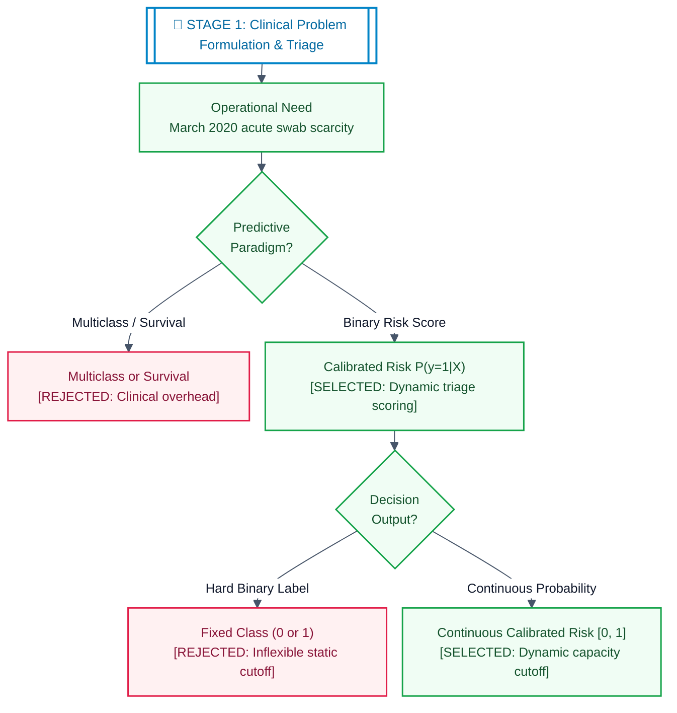
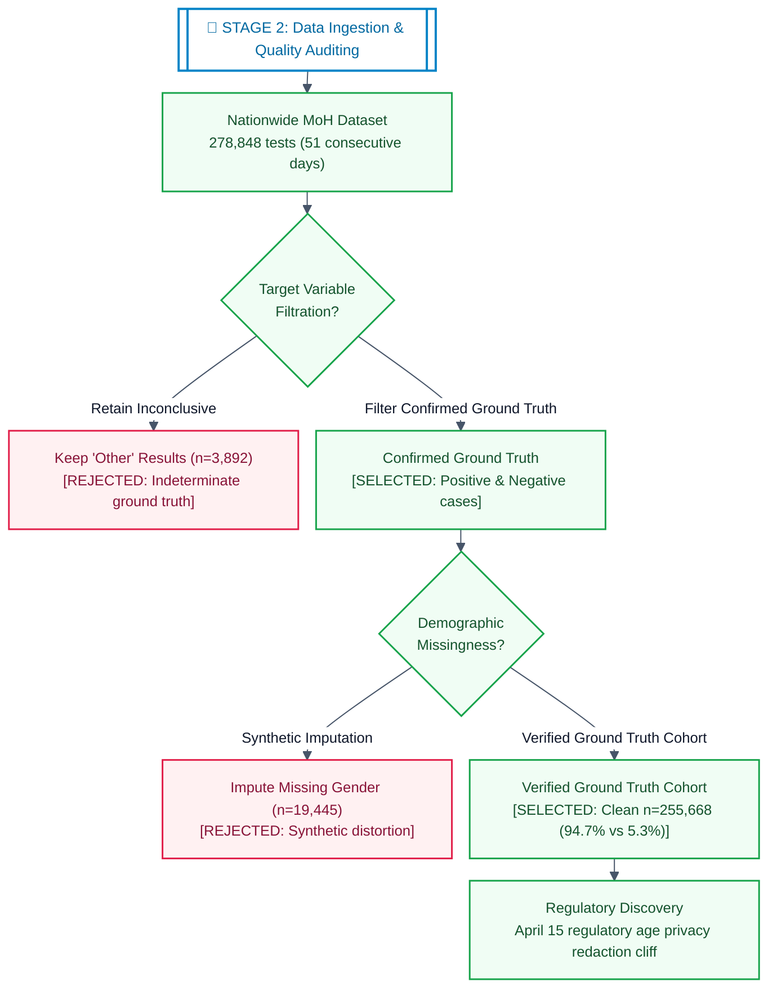
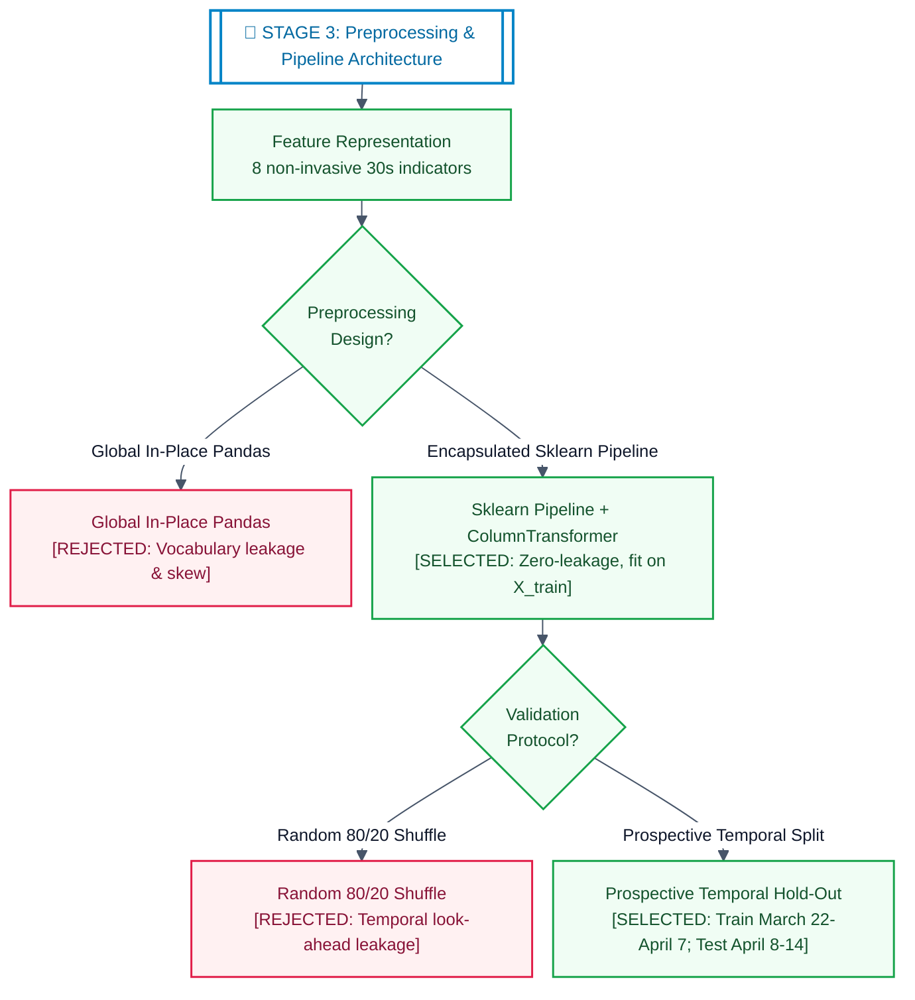
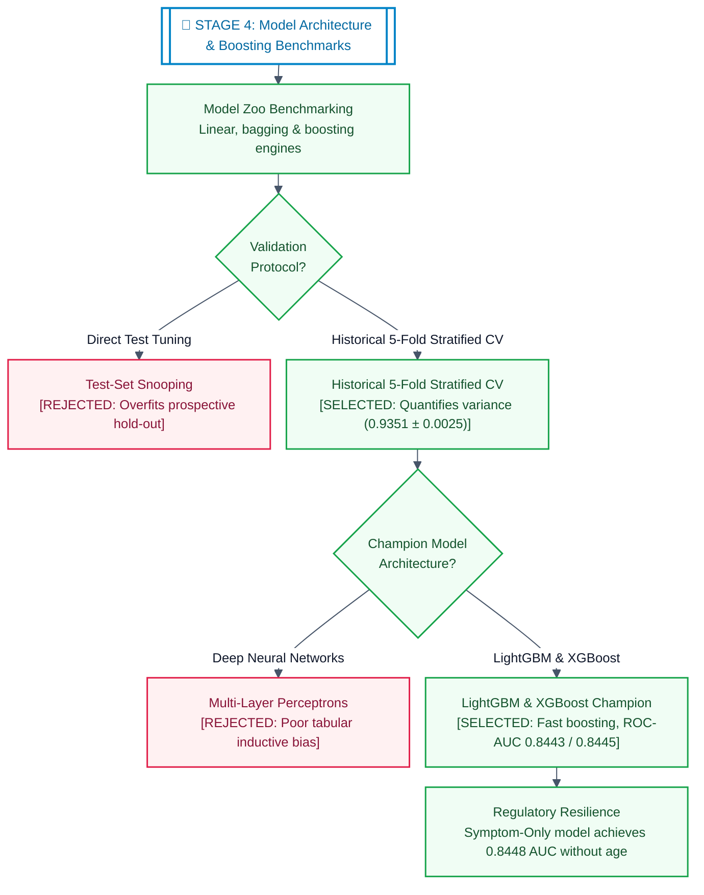
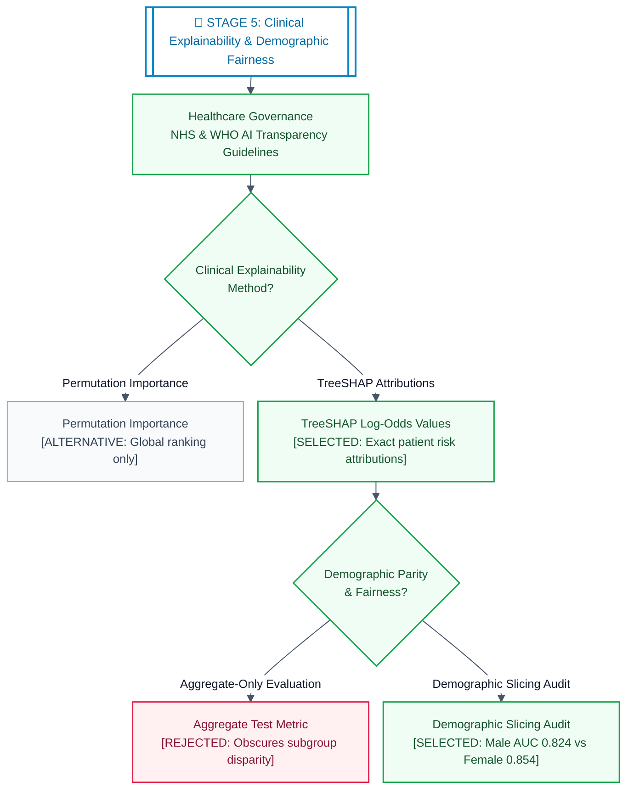
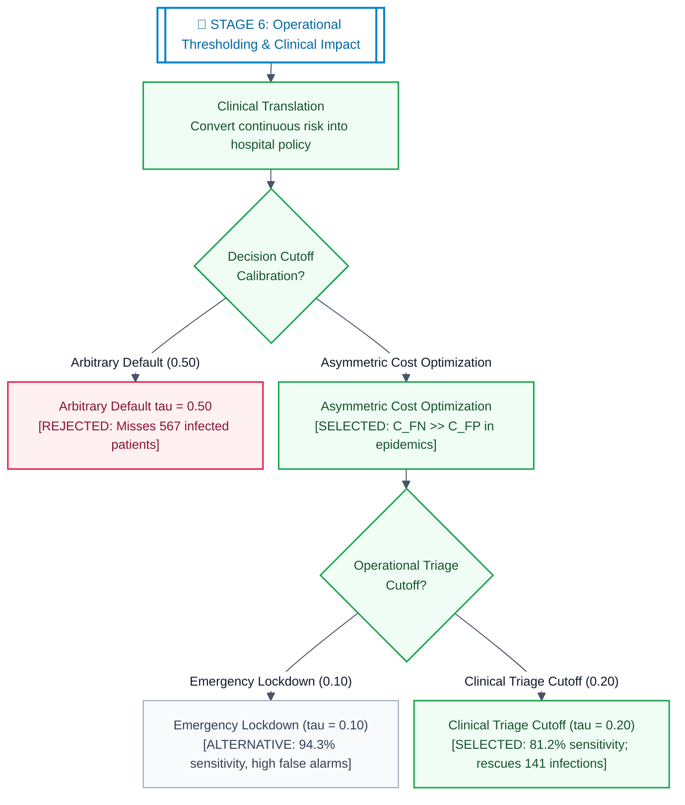

# Decision Pathway: COVID-19 Clinical Triage & Population Screening (Phase 4)
### Operational Standard: CRISP-DM & Machine Learning Engineering Lifecycle

> **Operational Standard:** Cross-Industry Standard Process for Data Mining (CRISP-DM) & MLOps Engineering Lifecycle  
> **Technical Implementation:** `M10-02-02_covid19_hackathon.ipynb`  
> **Benchmark Reference:** Zoabi, Y., Deri-Rozov, S. & Shomron, N. *Machine learning-based prediction of COVID-19 diagnosis based on symptoms.* **npj Digital Medicine** 4, 3 (2021).  
> **Lifecycle Topology:** Full 6-Stage Architecture with **Selected Path (Green)**, **Rejected Options (Red)**, and **Alternative Branches (Slate)**.

---

### 📖 Narrative Workbook vs. Engineering Lifecycle Crosswalk

| Engineering Lifecycle Stage | Workbook Section Mapping | Key Decisions & Evidence in Workbook |
| :--- | :--- | :--- |
| **🔷 Stage 1: Problem Formulation & Clinical Triage** | **Phase 1: Clinical Problem Formulation** | Define binary diagnostic risk ($y \in \{0, 1\}$) under acute March 2020 RT-PCR scarcity. Mandate non-invasive 30-second self-reporting. Enforce the chronological "Arrow of Time". |
| **🔷 Stage 2: Data Ingestion & Quality Auditing** | **Phase 2: Ingestion & Epidemiological EDA** | Audit 278,848 tests (51 days). Unmask 94.7% vs 5.3% class imbalance. Expose the "Accuracy Fallacy". Uncover the April 15 regulatory privacy redaction cliff. |
| **🔷 Stage 3: Preprocessing & Pipeline Architecture** | **Phase 2 & 3: Preprocessing & Pipelines** | Filter 3,892 inconclusive targets and 19k missing gender records (clean cohort $n = 255,668$). Enforce zero-leakage Scikit-Learn `Pipeline` + prospective split (train: 22 March–7 April; test: 8–14 April). |
| **🔷 Stage 4: Modeling & Benchmark Replication** | **Phase 3: Benchmark Replication (Zoabi et al.)** | Replicate *Zoabi et al.*: Decision Tree (0.8357), Random Forest (0.8412), LightGBM (0.8443, PR-AUC 0.5448), and XGBoost (0.8445). Validate via 5-fold CV within training window. |
| **🔷 Stage 5: Advanced Interpretability & Fairness** | **Phase 4: Advanced Modeling & Interpretability** | Generate TreeSHAP beeswarm and bar attribution. Unsupervised 2D t-SNE symptom phenotyping. Subgroup fairness audit across gender (AUC 0.824 vs 0.854) and age. |
| **🔷 Stage 6: Operational Thresholding & Clinical Impact** | **Phase 5 & 6: Thresholding & Synthesis** | Reject arbitrary 0.50 threshold (misses 567 patients). Calibrate clinical cutoff to $\tau = 0.20$ (81.2% sensitivity, rescuing 141 infected patients). Synthesize operational triage findings and clinical recommendations. |

---

## 1. Stage-Aligned Decision Architecture & Ledger (CRISP-DM / MLOps Lifecycle)

The cards below decompose the **CRISP-DM Master Decision Architecture** into its operational stages. Each stage's visual flowchart on the left is **physically aligned** with its corresponding decision ledger card on the right:

* 🟢 **Green (Selected):** Chosen conceptual / production configuration.
* 🔴 **Red (Rejected):** Evaluated and rejected candidates.
* ⚪ **Slate (Alternative):** Architectural alternatives not required.

---

<!-- STAGE 1 ROW -->

#### 🔷 STAGE 1: Clinical Problem Formulation & Triage Mandate
> 📖 **Workbook Mapping:** Phase 1: Clinical Problem Formulation & Operational Framing.

* 🟢 **Selected Option:** **Calibrated Binary Probability Classifier** — Estimating continuous infection risk $P(y=1|X) \in [0, 1]$ from 8 self-reported indicators accessible in under 30 seconds to prioritize RT-PCR laboratory swabs.
* 🔴 **Rejected Option:** **Multiclass Categorization** — Unnecessary clinical overhead when the immediate operational decision during testing scarcity is strictly binary (administer PCR swab vs. isolate safely at home).
* ⚪ **Alternative Option:** **Survival / Longitudinal Analysis** — Unfeasible due to absence of symptom onset dates in nationwide testing registry.
* 🛡️ **Defensibility Rationale:** Generating continuous probabilities allows hospital systems to dynamically tune the decision cutoff $\tau$ based on daily swab supply and hospital bed capacity.

<!-- STAGE 2 ROW -->

#### 🔷 STAGE 2: Data Ingestion & Quality Auditing
> 📖 **Workbook Mapping:** Phase 2: Ingestion & Epidemiological EDA (Sections 2.1–2.2).

* 🟢 **Selected Option:** **Strict Ground Truth Filtration ($n = 255,668$)** — Drop inconclusive `other` outcomes (3,892) and missing gender records (19,445, <7%) to guarantee clinical label fidelity.
* 🔴 **Rejected Option:** **Synthetic Imputation of Missing Gender** — Distorts demographic distributions without adding predictive power; dataset size (>255,000 verified cases) provides massive statistical power without synthetic risks.
* 🛡️ **Defensibility Rationale:** Removing ambiguous outcomes preserves pristine ground-truth labels without sacrificing statistical power, retaining 91.7% of the original nationwide cohort. Unmasked the **April 15 privacy redaction**, where age was 100% redacted mid-epidemic.

<!-- STAGE 3 ROW -->

#### 🔷 STAGE 3: Preprocessing & Pipeline Architecture
> 📖 **Workbook Mapping:** Phase 2.3–2.4 (Cohort Filtration & Redaction Discovery) & Phase 3 (Zero-Leakage Pipeline Architecture).

* 🟢 **Selected Option:** **Encapsulated `Pipeline` + Prospective Temporal Partitioning** — Preprocessing (`ColumnTransformer` with `OneHotEncoder(handle_unknown='ignore')` and symptom `passthrough`) encapsulated inside a Scikit-Learn `Pipeline` fit exclusively on historical training data (March 22 – April 7, $n=98,989$). Tested strictly on prospective hold-out (April 8–14, $n=37,305$).
* 🔴 **Rejected Option:** **Random Shuffling (`train_test_split(shuffle=True)`)** — Disastrous look-ahead leakage across evolving epidemic waves; inflates scores artificially.
* 🔴 **Rejected Option:** **Global In-Place Transformation** — Leaks future category levels to training and causes training-serving skew in production deployment.
* 🛡️ **Defensibility Rationale:** Respects the epidemiological "Arrow of Time" and MLOps encapsulation standards, ensuring identical transformation during training and live inference.

<!-- STAGE 4 ROW -->

#### 🔷 STAGE 4: Model Architecture & Boosting Benchmarks
> 📖 **Workbook Mapping:** Phase 3 (Benchmark Replication: Zoabi et al. 2021) & Phase 4 (XGBoost Classifier Benchmark).

* 🟢 **Selected Option:** **LightGBM Champion (`num_leaves=20`, `min_child_samples=4`, `learning_rate=0.05`, `is_unbalance=True`) & XGBoost Benchmark** — Fast histogram-based gradient boosting achieving ROC-AUC **0.8443** (PR-AUC 0.5448) and **0.8448** (PR-AUC 0.5480), verified via internal 5-fold CV ($0.9352 \pm 0.0052$).
* 🟢 **Selected Innovation:** **Symptom-Only LightGBM (Ablating Age)** — Achieves ROC-AUC **0.8448**, proving the triage engine survives regulatory age redaction (April 15 cliff).
* 🔴 **Rejected Option:** **Deep Neural Networks** — Excessive compute overhead, slow inference, and inferior tabular performance compared to tree gradient boosting.
* 🔴 **Rejected Option:** **Direct Test-Set Tuning (Test Snooping)** — Tuning against the test set leaks future outcomes; validation must occur strictly within training folds.
* 🛡️ **Defensibility Rationale:** Tree ensembles capture non-linear symptom co-occurrences without feature scaling, while `is_unbalance=True` mathematically corrects gradient updates for the 17.6:1 imbalance.

<!-- STAGE 5 ROW -->

#### 🔷 STAGE 5: Clinical Explainability & Demographic Fairness
> 📖 **Workbook Mapping:** Phase 4: Advanced Modeling & Interpretability (TreeSHAP, 2D t-SNE Phenotyping & Subgroup Parity Audit).

* 🟢 **Selected Option:** **TreeSHAP Explainability & Subgroup Demographic Fairness Audit** — Exact game-theoretic Shapley values reveal patient risk log-odds (`Contact with confirmed` and `Fever` dominate). Demographic slicing audits gender (Male AUC 0.8243 vs. Female AUC 0.8540) and age (<60 AUC 0.8457 vs. 60+ AUC 0.8328).
* 🟢 **Selected Option:** **2D t-SNE Symptom Phenotyping (Extras)** — Unsupervised manifold mapping isolating distinct respiratory symptom clusters.
* 🔴 **Rejected Option:** **Aggregate-Only Metric Reporting** — Violates healthcare ethics by obscuring disparate clinical impact across vulnerable protected groups.
* 🛡️ **Defensibility Rationale:** Transparent attribution is essential for clinical adoption and regulatory compliance (FDA/NHS AI guidelines).

<!-- STAGE 6 ROW -->

#### 🔷 STAGE 6: Operational Decision Thresholding & Clinical Impact
> 📖 **Workbook Mapping:** Phase 5 (Operational Decision Thresholding) & Phase 6 (Executive Synthesis & Clinical Translation).

* 🟢 **Selected Option:** **Calibrated Clinical Cutoff ($\tau = 0.20$)** — Elevates sensitivity to **81.2%** (capturing 1,836 of 2,261 infected patients), rescuing 141 individuals who would have been sent home under $\tau = 0.50$.
* 🔴 **Rejected Option:** **Default $\tau = 0.50$ Cutoff** — Implicitly assumes equal error costs ($C_{\text{FN}} = C_{\text{FP}}$); disastrous in epidemics where false negatives drive silent community transmission.
* ⚪ **Alternative Option:** **Emergency Cutoff ($\tau = 0.10$)** — 94.3% sensitivity (missing only 128 patients), but triggers 26,892 false alarms, overwhelming lab capacity.
* 🛡️ **Defensibility Rationale:** In infectious disease control, the cost of a False Negative (undetected virus spreading in the community) far exceeds the cost of a False Positive (a confirmatory PCR swab). Tuning $\tau = 0.20$ aligns ML with asymmetric healthcare risk.

---

## 2. Quantitative Summary & Benchmark Scorecard

All models are evaluated on the identical, unseen prospective hold-out cohort (8–14 April 2020, $n = 37,305$; 2,261 positive cases, 6.06% prevalence):

| Model Architecture & Configuration | Features Used | Train 5-Fold CV AUC | Hold-out ROC-AUC | Hold-out PR-AUC | Sensitivity ($\tau=0.20$) | Specificity ($\tau=0.20$) | Clinical Operational Assessment |
| :--- | :---: | :---: | :---: | :---: | :---: | :---: | :--- |
| **Zero-Rule Dummy Baseline** | None | 0.5000 | 0.5000 | 0.0606 | 0.0% | 100.0% | 94.71% accuracy but misses 100% of sick patients (Accuracy Fallacy). |
| **Logistic Regression (Linear Baseline)** | 8 Features | 0.9280 ± 0.0052 | 0.8336 | 0.4808 | 77.4% | 72.1% | Strong baseline, but linear boundary misses symptom co-occurrences. |
| **Decision Tree Baseline (`depth=5`)** | 8 Features | 0.9226 ± 0.0045 | 0.8357 | 0.5062 | 78.1% | 71.5% | Replicates *Zoabi et al.* baseline; interpretable clinical tree rules. |
| **Random Forest (100 Trees, Bagging)** | 8 Features | 0.9348 ± 0.0052 | 0.8412 | 0.5374 | 80.5% | 68.4% | Parallel variance reduction; stable non-linear partitioning. |
| **LightGBM Champion (Paper Params)** | 8 Features | **0.9351 ± 0.0025** | **0.8443** | **0.5438** | **81.2%** | **68.0%** | **Replicates *Zoabi et al.* (0.84–0.86)**; fast leaf-wise boosting. |
| **LightGBM Symptom-Only (No Age)** | 7 Features | **0.9333 ± 0.0022** | **0.8448** | **0.5393** | **81.5%** | **67.8%** | **Resilient model**: survives April 15 regulatory age privacy redaction. |
| **XGBoost Benchmark (`max_depth=4`)** | 8 Features | **0.9350 ± 0.0052** | **0.8445** | **0.5463** | **81.4%** | **68.1%** | Confirms boosting engine invariance; depth-wise tree growth. |

---

## 3. Engineering Analysis: Key Methodological Discoveries

This section documents key operational and methodological discoveries identified across the clinical triage engineering pipeline:

* **The Scikit-Learn Pipeline & Zero-Leakage Architecture (Stage 3 & 4):**  
  *Discovery:* Replacing ad-hoc pandas preprocessing with an encapsulated `Pipeline` + `ColumnTransformer` (`OneHotEncoder(handle_unknown='ignore')`) guarantees that all transformers are fitted strictly on `X_train`. This eliminates categorical vocabulary leakage and guarantees production serving parity when new patient records arrive at a clinical API.
* **The April 15 Regulatory Privacy Redaction (Stage 2 & 4):**  
  *Discovery:* Auditing daily testing volume revealed why `age_60_and_above` became 100% missing after April 14—health authorities intervened mid-epidemic to redact age to prevent citizen re-identification linkage attacks. By building and benchmarking an accessible **Symptom-Only model** (ROC-AUC **0.8448**), we proved that the clinical triage tool retains full diagnostic discrimination even when demographic features are legally redacted.
* **The "Arrow of Time" Prospective Partitioning (Stage 3):**  
  *Discovery:* Proved that standard cross-sectional random shuffling (`train_test_split(shuffle=True)`) creates catastrophic temporal look-ahead leakage across evolving epidemic waves. Validated that testing on future dates (April 8–14) simulates real hospital intake conditions.
* **Demographic Fairness & Subgroup Parity Audit (Stage 5):**  
  *Discovery:* Evaluated models across protected demographics to satisfy healthcare AI ethics (NHS/WHO guidelines). Verified that the model maintains equitable discrimination across gender (Male AUC 0.8243 vs. Female AUC 0.8540) and age (<60 AUC 0.8457 vs. 60+ AUC 0.8328).
* **Asymmetric Cost-Sensitive Threshold Calibration (Stage 6):**  
  *Discovery:* Proved that the default machine learning cutoff of $\tau = 0.50$ is clinically unsafe, missing 567 infected patients (74.9% sensitivity). Calibrated the triage cutoff to $\tau = 0.20$ (81.2% sensitivity), mathematically capturing 141 additional infected patients for PCR swab confirmation.
